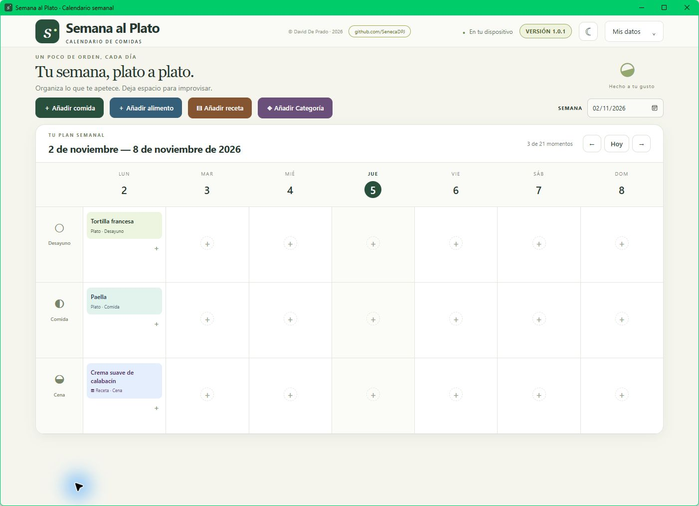

# Semana al Plato

**Your week, one meal at a time.** A meal planner for Windows 11 to organise breakfast, lunch and dinner, keep your recipes and build a menu that suits you.

[Español](README.md) · **English**

[Download for Windows 11 · x64 · v1.0.2](https://github.com/SenecaDPJ/semana-al-plato/releases/download/v1.0.2/Semana_al_Plato_1.0.2_x64-setup.exe) · [Releases](https://github.com/SenecaDPJ/semana-al-plato/releases) · [Report an issue](https://github.com/SenecaDPJ/semana-al-plato/issues)



## What you can do

Semana al Plato brings your calendar and catalogues together. Plan complete dishes, add individual food items, or schedule recipes with ingredients and preparation steps. Each slot supports multiple entries: for example, coffee, toast and fruit for Monday's breakfast.

It works locally, without an account or a meal-planning service. Your menu stays on your device and can be transferred through a JSON backup. Everyday planning does not require a connection; downloading the application and setting up its development tools may require one.

| Feature | What it does |
| --- | --- |
| Monday-to-Sunday calendar | Shows a full week with breakfast, lunch and dinner every day. |
| Current week on startup | Opens the relevant week and highlights the current day. |
| Week picker, arrows and Today | Lets you plan future weeks, review previous ones and return to the current week. |
| Multiple entries per slot | Combines dishes, drinks, food items and recipes without replacing existing entries. |
| Editable catalogues | Creates, searches, filters by category, edits and deletes dishes and food items. |
| Colour-coded categories | Provides 14 text colours and 14 fills: 196 predefined high-contrast combinations. |
| Built-in recipe collection | Stores ingredients, instructions, minutes and servings, and schedules recipes. |
| Non-modal recipe panels | Keeps the calendar usable while viewing a recipe; panels can be moved by their headers. |
| Light and dark themes | Switches appearance with the moon/sun button and remembers the choice. |
| Local saving and JSON backups | Retains your plans and lets you export or restore them. |
| Change confirmation | Lets you review where an entry will be added and confirm deletions. |

## Download and install

1. Download **Semana_al_Plato_1.0.2_x64-setup.exe** using the link above or the [v1.0.2 release](https://github.com/SenecaDPJ/semana-al-plato/releases/tag/v1.0.2).
2. Run the installer and follow its instructions.
3. Open **Semana al Plato** and start planning.

The available installer targets **64-bit Windows 11**. You do not need Node.js, Rust or programming tools to use it. The application uses Microsoft Edge WebView2 to render its interface on Windows.

**Project status:** the author is currently the only person who has installed the application. It is not presented as community-validated software or as tested on other computers. Recorded build and verification details are available in [VALIDACION.md](VALIDACION.md).

## Getting started

The application currently uses Spanish labels. The instructions below keep those labels so you can find the controls.

### 1. Choose a week

The current week appears on startup. Under **SEMANA** (week), choose any date to display the week containing it. Use **← / →** to move between weeks and **Hoy** (today) to return to the current week.

The three rows are **Desayuno** (breakfast), **Comida** (lunch) and **Cena** (dinner). The “X de 21 momentos” counter shows how many slots contain entries, not the number of dishes or servings.

### 2. Add what you want to eat

There are two starting points:

- **Top buttons:** select **Añadir comida** (add a dish) or **Añadir alimento** (add a food item), search or filter the catalogue and choose an entry. A banner asks you to select a slot. Click the desired day and meal, then confirm.
- **A calendar slot:** click **+**, choose a dish, food item or recipe, select the entry and confirm adding it to that slot.

Repeat to add several entries. Existing entries are retained. **Cancelar** (cancel) exits without adding the entry.

**Example:** add “Café”, “Tostada con tomate” and “Fruta” to Monday's breakfast. Food items and complete dishes can share a slot.

### 3. Personalise your catalogues

In the relevant catalogue, select **Añadir nueva comida** (add a new dish) or **Añadir nuevo alimento** (add a new food item), enter a name and assign a category. Built-in entries can also be edited with **Editar** or deleted with **Eliminar**.

Duplicate names are rejected within each catalogue, ignoring differences in letter case, accents and repeated spaces. Editing an entry updates its appearances in the calendar.

### 4. Organise with categories

Select **Añadir Categoría** (add a category), enter a name and choose text and fill colours. A preview shows the result before you save it.

The original **Desayuno**, **Comida** and **Cena** categories are protected. Custom categories can be edited and deleted, provided no food items, dishes or recipes use them.

Categories are labels: they do not add calendar rows or restrict placement. A dish categorised as dinner can also be scheduled for lunch.

### 5. Use your recipes

Select **Añadir receta** (add a recipe) to open the collection. Double-click a recipe or select **Abrir** (open) to view its ingredients and instructions in another panel. Both panels leave the calendar usable.

Use **Crear nueva receta** (create a new recipe) to save a name, category, minutes, servings, ingredients and steps. Recipes can be edited, deleted and scheduled with **Al calendario** or **Añadir al calendario** (add to calendar).

### 6. Change the theme

Click the **☾ / ☀** button in the header to switch between light and dark themes. The preference is saved locally. This is a manual choice; there is no setting to follow the operating system theme automatically.

### 7. Remove an entry without deleting it from the catalogue

Click an entry in the calendar and choose **Eliminar de esta casilla** (remove from this slot). It remains available for other days.

Deleting it from its catalogue or the recipe collection also removes its calendar appearances. The confirmation reports the affected appearances.

## Starter content

The first run includes **30 food items and 30 dishes**: ten of each type for each original category. These are editable examples, not a mandatory meal plan.

| Category | Example food items | Example dishes |
| --- | --- | --- |
| Breakfast | Coffee, milk, fruit, oats | Omelette, tomato toast, yoghurt with fruit |
| Lunch | Lettuce, oily fish, chickpeas | Spaghetti Bolognese, cocido, paella |
| Dinner | Rice, eggs, courgette | Poached hake fillet, boiled egg, courgette soup |

The recipe collection starts with **tomato and olive oil toast**, **simple chickpea salad** and **smooth courgette soup**, including ingredients, steps, time and servings. Starter content is displayed in Spanish in the application.

## Your data and backups

Confirmed changes are saved automatically in the application's local storage. There is no account, menu server or automatic cross-device synchronisation.

- **Export:** open **Mis datos → Exportar copia** (my data → export backup). The Windows application opens a native dialog to choose where to save `Semana_al_Plato_copia.json`. The standalone HTML version starts a browser download.
- **Restore:** open **Mis datos → Restaurar copia** (restore backup), choose a compatible JSON file and confirm. Its structure is validated before changes are applied.
- **Backup contents:** calendar, food items, dishes, recipes and categories. The theme preference is stored separately and **is not included**.
- **Replace, not merge:** restoring replaces current data. Export first if you want to keep it. Files of up to 5 MB are accepted.
- **Another device or browser:** use export and restore. The standalone HTML and installed application do not share their data automatically.

Keep backups before clearing application data, changing computers or making major changes. A JSON file contains the names and text you entered: only share it if you also intend to share that information.

## Technologies and development

| Technology | Role |
| --- | --- |
| HTML, CSS and modular JavaScript | Calendar, forms, panels, themes and interactions, without a frontend framework. |
| Tauri 2 and Rust | Desktop shell and native functions, including a Windows backup save dialog. |
| Microsoft Edge WebView2 | Interface rendering engine on Windows. |
| localStorage and JSON | Local persistence and structurally validated backups. |
| Node.js | Local development server and standalone HTML generation. |
| Node Test Runner and jsdom | Logic and interaction tests in a simulated DOM. |
| NSIS | Windows installer generation. |

Separating the logic, interface and desktop shell supports work on future ports. **Linux/Ubuntu and Android remain future targets; this release does not provide verified native versions for those systems.**

### Run from source

This section is for development and builds; it is not required to install the EXE. The interface requires Node.js compatible with the project's dependencies. Windows Tauri builds also require Rust/MSVC, Microsoft C++ Build Tools, the Windows SDK and WebView2. See the [Tauri prerequisites](https://v2.tauri.app/start/prerequisites/).

Run these commands from the repository root.

🔴 EJECUCIÓN⚙️🚨 — Installs locked dependencies into `node_modules`.

```powershell
npm ci
```

🔴 EJECUCIÓN⚙️🚨 — Regenerates `dist/` and runs tests. Does not modify the user's saved menus.

```powershell
npm test
```

🔴 EJECUCIÓN⚙️🚨 — Starts the local interface server; open `http://127.0.0.1:1420`. Stop it with Ctrl+C.

```powershell
npm run dev
```

🔴 EJECUCIÓN⚙️🚨 — Builds and opens the desktop application in development mode; may download dependencies and create build files.

```powershell
npm run tauri -- dev
```

🔴 EJECUCIÓN⚙️🚨 — Generates the interface and Windows installer. Does not install the resulting application automatically.

```powershell
npm run tauri -- build
```

The installer is generated in `src-tauri/target/release/bundle/nsis/`. `npm run build` produces `dist/index.html`, which can also be opened in Edge as standalone HTML. Edit `src/` and `index.html`; `dist/` is generated.

| Path | Contents |
| --- | --- |
| `src/domain.js` | Local dates, starter data, rules and validation |
| `src/storage.js` | Persistence and backup export |
| `src/app.js` | Calendar, catalogues, recipes and theme |
| `src/style.css` | Layout, size adaptation and themes |
| `scripts/` | Build and development server |
| `tests/` | Logic and simulated interaction tests |
| `src-tauri/` | Rust code, native configuration and icons |
| `docs/` | Documentation resources |

## Current scope

The application interface is in **Spanish**. This documentation is fully available in Spanish and English; this does not imply an in-app language selector.

There is no automatic menu generation, nutritional analysis, automatic shopping list or cloud synchronisation. Simulated tests do not replace real installation, window and saving checks on Windows.

## Author and licence

Created by [David De Prado · SenecaDPJ](https://github.com/SenecaDPJ).

© 2026 David De Prado. Distributed under the [MIT licence](LICENSE).
