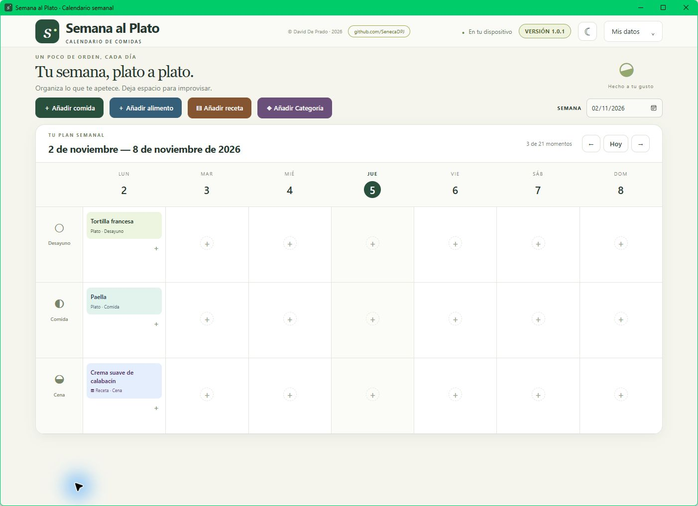

# Semana al Plato

**Calendario interactivo de comidas, alimentos y recetas para Windows 11.**

*Interactive Meal and Recipe Planner for Windows 11.*

**Descarga / Download:** [instalador Windows 11 (v1.0.1)](https://github.com/SenecaDPJ/semana-al-plato/releases/download/v1.0.1/Semana_al_Plato_1.0.1_x64-setup.exe)



Semana al Plato permite organizar desayunos, comidas y cenas por semana. Puedes crear y editar platos, alimentos, recetas y categorías; añadir varios elementos a cada casilla; cambiar entre tema claro y oscuro; y exportar o restaurar una copia JSON. Funciona localmente, sin cuenta ni sincronización.

**English:** Semana al Plato is a local weekly meal planner for Windows 11. Organize breakfast, lunch and dinner; manage meals, foods, recipes and categories; switch between light and dark themes; and export or restore a JSON backup. No account or synchronization is required.

## Instalar en Windows 11

El proyecto genera un instalador NSIS x64 con Tauri 2. Para compilarlo necesitas Node.js, Rust con toolchain MSVC, Microsoft C++ Build Tools con el SDK de Windows y WebView2. Consulta los [requisitos oficiales de Tauri](https://v2.tauri.app/start/prerequisites/).

```powershell
npm ci
npm test
npm run tauri -- build
```

El instalador resultante queda en `src-tauri/target/release/bundle/nsis/`. No está incluido en Git. Para desarrollar la interfaz, ejecuta `npm run dev` y abre `http://127.0.0.1:1420`. `npm run build` genera `dist/index.html`, que también se puede abrir en Edge como HTML autónomo. No edites `dist/`: se regenera desde `src/` e `index.html`.

## Datos y copias

Los datos se guardan en el almacenamiento local de la aplicación. **Antes de instalar o actualizar desde una versión anterior con otro nombre, exporta una copia en «Mis datos».** El cambio de marca conserva el identificador interno de Tauri y las claves de almacenamiento existentes, pero la conservación de datos durante la actualización debe comprobarse en Windows.

«Mis datos → Exportar copia» abre en Windows un diálogo para elegir dónde guardar `Semana_al_Plato_copia.json`; en el HTML autónomo inicia una descarga. La aplicación indica si el guardado terminó o falló. «Restaurar copia» valida el archivo antes de sustituir los datos actuales. La preferencia de tema se guarda aparte y no forma parte de la copia. La aplicación no sincroniza entre dispositivos.

## Estructura

| Ruta | Función |
| --- | --- |
| `src/domain.js` | Fechas locales, datos iniciales y validación |
| `src/storage.js` | Almacenamiento local y copia JSON |
| `src/app.js` | Interacciones y calendario |
| `src/style.css` | Interfaz y temas |
| `scripts/` | Construcción del HTML autónomo y servidor local |
| `tests/` | Pruebas de dominio e interacción simulada |
| `src-tauri/` | Aplicación nativa de Windows e iconos |

El identificador `com.senecadpj.calendariocomidas` y las claves `calendario-comidas.v1` y `calendario-comidas.theme` son deliberadamente anteriores al cambio de marca: preservan la ruta de datos de las instalaciones existentes.

## Licencia

MIT. Véase [LICENSE](LICENSE). © 2026 David De Prado.
